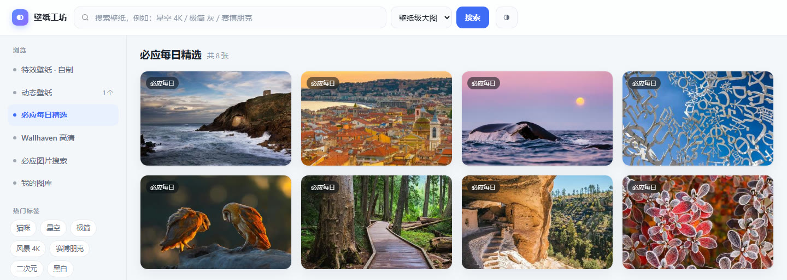

# 壁纸工坊 · Wallpaper Studio

> 免费、开源、无广告的 Windows 桌面壁纸工具。不想装 Python？到 [Releases](https://github.com/chaserr/wallpaper-studio/releases/latest) 下载免安装版，解压双击即用。

一个跑在 Windows 本机的桌面壁纸工具：找图、存图、换壁纸，外加一个能自己做粒子特效壁纸的工作室。
界面是 pywebview 原生窗口，后端只有 Python 标准库，数据全部留在本地。




## 为什么用它

壁纸软件这行怪得很：要么一打开先看广告，要么把「动态壁纸」锁进会员，要么在后台常驻做些说不清的事。
这个工具的思路很朴素 —— **把该有的功能都做齐，然后什么都不加**。

- **没有广告、没有会员、没有弹窗**：打开就是图。不推销皮肤、不逼你签到、不弹「升级专业版」
- **不上传、不收集、不联网也能用**：除了「拉必应每日图 / Wallhaven / Mixkit 视频」这些本来就要网的事，其余全在本机跑；
  不上报使用数据，不传你的图片，不写注册表开机自启
- **该有的都有，不比线上那些差**：每日精选、关键词搜高清图、Wallhaven 分类/分辨率/排序筛选、
  本地图库管理、mp4/webm/GIF 动态壁纸、定时轮播、上一张回滚 —— 一样不缺
- **真的能自己改**：12 种粒子特效的「数量 / 大小 / 速度 / 浓淡 / 颜色」全可调，
  鼠标跟随光晕、点击涟漪、桌面时钟与文字，参数实时预览；调顺眼了一键存成「场景」，下次直接套
- **拿自己的照片做立体壁纸**：照片视差（伪 3D），同一张图拆成清晰近层 + 虚化远层，鼠标一动两层就错开
- **数据是你自己的**：图库就是你硬盘上的一个文件夹，普通 jpg/png，不加密、不打包、不锁格式；
  卸载软件图还在，换台电脑拷过去就能用

和常见商业壁纸软件比一比：

|  | 壁纸工坊 | 常见商业壁纸软件 |
| --- | --- | --- |
| 广告 | 没有，界面上一个广告位都没留 | 开屏广告、信息流、弹窗 |
| 会员 | 没有会员体系 | 动态壁纸 / 4K 素材常要开会员 |
| 账号 | 不需要 | 强制登录、绑手机 |
| 数据 | 全在本机，不上传 | 上传云端、做用户画像 |
| 特效壁纸 | 12 种粒子，参数全可调，能存自己的场景 | 只能套固定模板 |
| 图库 | 硬盘上一个普通文件夹 | 私有格式，锁在应用里 |
| 动态壁纸 | mp4 / webm / GIF 直接铺到桌面图标下方 | 支持，但常按素材收费 |
| 价格 | 免费，源码公开 | 订阅制 |

一句话：不用为「去广告」付费，也不用为「换张壁纸」装一堆东西。


## 功能

- **必应每日精选**：拉取必应每日一图，可选 4K
- **必应图片搜索**：任意关键词，可筛「壁纸级大图」，下滑自动翻页
- **Wallhaven 高清**：分类 / 分辨率 / 排序筛选（需系统代理）
- **我的图库**：所有设为壁纸的图都会存进本地图库
  - 缩略图直接预览，点开看原图
  - 一键设为桌面壁纸
  - 删除（二次确认 → 移入 Windows 回收站，可还原）
  - 定时轮播、上一张回滚
- **动态壁纸**：导入本机 mp4/webm/GIF，或从 Mixkit 在线素材库挑免费视频，
  用 WorkerW 铺到桌面图标之下，自带 30fps 左右的 ffmpeg 视频解码
- **特效壁纸 · 自制**：背景（渐变/图片/视频/照片视差），12 种粒子（雨、雪、花瓣、萤火虫、
  气泡、火星、星光、落叶、极光、光斑、星空穿越、流星），鼠标互动（跟随光晕、点击涟漪），
  时钟文字，参数实时预览，可保存成「场景」随时套用
  - 选背景图时优先从「我的壁纸」缩略图里点选，也可以从电脑另导一张
- **12 套风格预设**：雨夜霓虹 / 极光雪原 / 樱落春溪 / 萤火森林 / 深海微光 / 赛博星河 /
  壁炉余烬 / 银河穿越 / 晨雾微光 / 金色庆典 / 流星夜空 / 秋日落叶
  —— 一键载入整套参数，再改颜色和数量存成自己的
- **照片视差（伪 3D）**：拿自己的照片当背景，同一张图拆成「清晰近层 + 虚化远层」，
  鼠标在桌面上移动时两层按不同比例错开，像看立体照片；虚化量、清晰区大小、视差强度可调
  - 近层的羽化遮罩用 ffmpeg `alphamerge` 合成，再 `geq` 预乘 alpha 供 `AlphaBlend` 用

## 运行

```bat
python app.py          :: 桌面窗口
python app.py --browser  :: 退化成浏览器标签页（没有 WebView2 时）
```

没有 pywebview 时会自动回退到浏览器模式，所以最小依赖是「有 Python 就行」。

## 依赖

| 用途 | 依赖 | 是否必需 |
| --- | --- | --- |
| 原生桌面窗口 | `pywebview` + `pythonnet` | 可选，缺失则用浏览器 |
| 动态壁纸解码 | `imageio-ffmpeg` 提供的 `ffmpeg.exe` | 可选，缺失则动态壁纸不可用 |

`vendor/` 目录放的是打包用的 ffmpeg 二进制，体积大，未入库。想启用动态壁纸，可以：

```bat
pip install imageio-ffmpeg
```

或把 `ffmpeg.exe` 放到 `vendor\imageio_ffmpeg\binaries\` 下，或直接装进系统 PATH。

## 目录结构

```
app.py            HTTP 服务 + 壁纸设置 + 图库/场景/动态壁纸接口 + 桌面窗口
dynwall.py        动态壁纸引擎（WorkerW 层 + ffmpeg rawvideo 管道）
fx.py             特效壁纸渲染引擎（GDI/AlphaBlend/粒子/涟漪/文字/照片视差）
ui/index.html     主界面（单文件，含样式与脚本）
ui/studio.js      自制特效壁纸的参数面板与 Canvas 预览
ui/studio.css
_mkicon.py        纯标准库生成 icon.ico
start.bat         Windows 启动脚本
```

壁纸与场景数据不在仓库里，默认存于 `E:\Wallpapers`（无 E 盘则落到 `图片\Wallpapers`），
可用环境变量 `WALLPAPER_DATA_ROOT` 覆盖。

## 打包

```bat
pyinstaller --noconfirm --distpath _build --workpath _build/work _build\壁纸工坊.spec
```

## 许可证

[MIT](LICENSE) —— 随便用、随便改、随便分发，保留版权声明即可。

壁纸与视频素材来自必应、Wallhaven、Mixkit，版权归各自作者所有，本工具只做本地缓存与展示。
